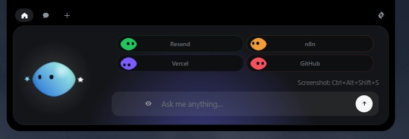
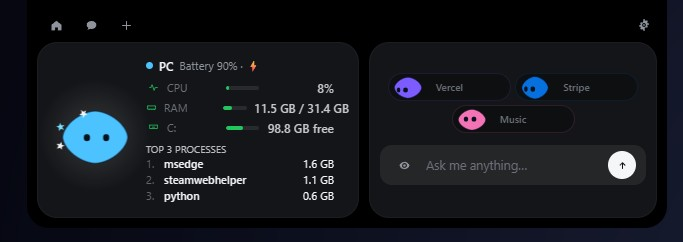
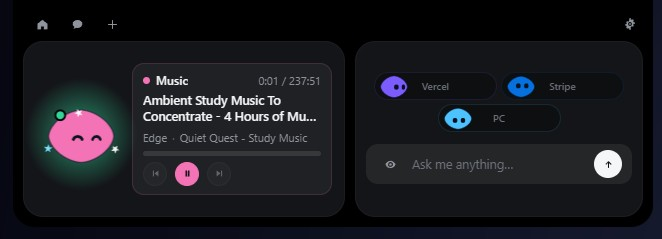
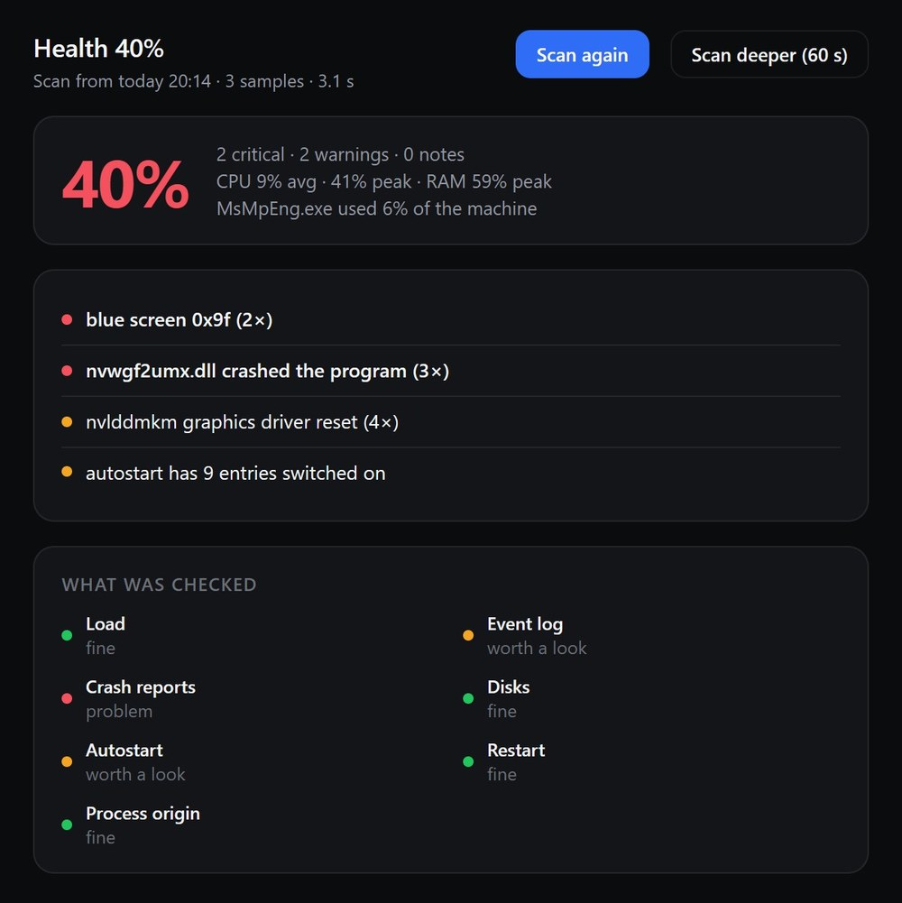
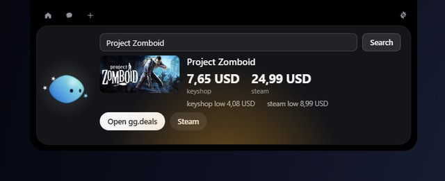
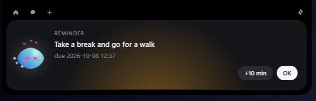
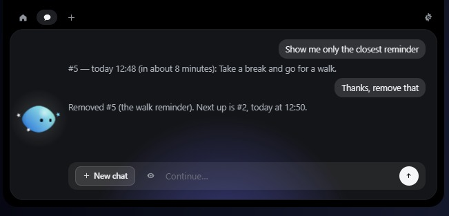
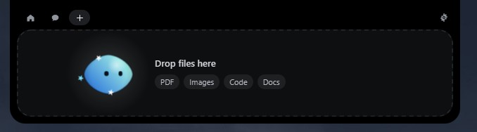
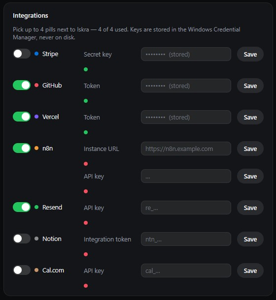
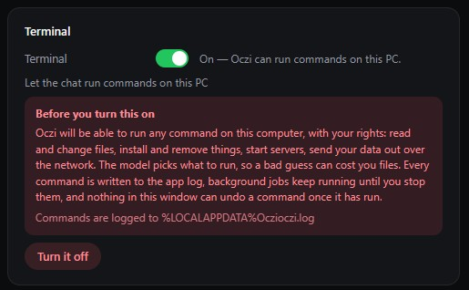

<div align="center">

# Oczi for Windows

**Oczi — a tiny crystal that lives at the top of your screen.**

Drop a file, chat through DeepSeek or Gemini — the Gemini key is free — snap a region screenshot, all without leaving what you're doing.




</div>

---

## What it does

Oczi is a small crystal with three shards orbiting her, sitting at the top centre of the
screen. She follows your cursor with her eyes, gets annoyed when poked, gets dizzy if you
insist — and does the small jobs without pulling you out of what you were doing.

- 📎 **Files** — drop one on her and ask about it; the original is only ever copied.
- 💬 **Chat** — DeepSeek or Gemini, your own key. The Gemini key is free.
- ⏰ **Reminders** — ask in the chat; a card arrives on time with **OK** and **+10 min**. Daily, working days or weekly.
- 🔁 **Routines** — say what to do and when: opening programs, pages, music, closing a process.
- 🖱️ **The eye** — drag a region of the screen onto your next question.
- 📌 **Pinned screenshots** — `Ctrl+Alt+Shift+P` pins a region on top of everything, on any monitor.
- 🩺 **Health** — one click reads load, logs, disks, startup and crashes down to the driver, then scores.
- 🧹 **Debloat** — the packages Windows brought with it, removed only where you tick, and the result read back.
- ⏱️ **Watch** — 15 or 30 minutes of every freeze, with the process that was on the processor then.
- 🏷️ **Game prices** — type a title; the cheapest key beside Steam's price, both record lows.
- 🫥 **Out of the way** — hides in the top edge; `Ctrl+Alt+M` summons her, `Ctrl+Alt+Shift+S` snips.
- 🔒 **Private by design** — no account, no telemetry; keys live in the Credential Manager.
- 🌍 **English or Polish** — one setting away.
- 🖥️ **Terminal** — off by default. Switched on, the chat can run commands on your PC: help with code, fixing what is broken, opening a program.

**Pills.** Next to Oczi sit her services, each with its own little coloured character:
**PC** (the three tools above, plus CPU, RAM, disks and battery), **Music** (whatever Windows
is playing, with play/pause and skip), **Games**, plus **Stripe**, **n8n**, **GitHub**,
**Vercel**, **Resend**, **Notion** and **Cal.com**. PC and Music need no key and come
switched on; the rest wait until you pick them.

Everything under the hood — the runtime, the terminal, the log, the layout — is in
[`windows/README.md`](windows/README.md).

## Screenshots

<table>
<tr>
<td width="50%" valign="top"><br>
<em>PC — your own machine's numbers.</em></td>
<td width="50%" valign="top"><br>
<em>Music — the current track, with play/pause and skip.</em></td>
</tr>
</table>



*Health — a score, the findings, and the driver behind each.*



*Games — the cheapest key beside Steam's price, both record lows.*

<table>
<tr>
<td width="50%" valign="top"><br>
<em>A reminder arrives as its own card.</em></td>
<td width="50%" valign="top"><br>
<em>The chat and the cards are the same list.</em></td>
</tr>
</table>



*Drop a file and she takes it — the original is copied into an inbox, never touched.*

<table>
<tr>
<td width="50%" valign="top"><br>
<em>Integrations: a pill per service, keys masked.</em></td>
<td width="50%" valign="top"><br>
<em>Terminal is off by default and says what it will do first.</em></td>
</tr>
</table>

## Install

Download **`Oczi-Windows-0.5.2-setup.exe`** from
[Releases](https://github.com/Adamowyy/oczi/releases/latest) and run it. Windows 10 or 11;
WebView2 is already on a normal install, and the installer offers it if it is missing.

The installer is **not code-signed**, so SmartScreen may warn (*More info → Run anyway*).
Build it from source if that bothers you.

Oczi asks for a key on first run (Settings → Chat) and lets you pick the provider.
**Gemini** is the free one: a key from [Google AI Studio](https://aistudio.google.com/apikey)
costs nothing, no card and no billing. **DeepSeek** is paid per use. Without a key she can
still sit there and look pretty, but she cannot answer anything.

## Game prices and GG.deals

The **Games** pill needs a free API key from [gg.deals](https://gg.deals/settings/)
(Settings → API) and a region code (`pl`, `de`, `gb`, `us`…), which picks the currency —
`pl` gets złoty, and without a region the API answers in dollars. Free keys are meant for
personal, hobby and open-source use, so Oczi shows the link back to the game's GG.deals page
that their terms ask for. The card reads only GG.deals' `prices/by-steam-app-id` and Steam's
store search; nothing is scraped and nothing about your library leaves the machine.

## Build from source

You need [Rust](https://rustup.rs), [Node 20+](https://nodejs.org), and the **MSVC build tools** (or the GNU toolchain — see the Windows readme).

```powershell
cd windows
npm install
npm run tauri dev      # live-reloading development build
npm run pack           # installer lands in windows/release/
```

## License

The **code** is [MIT](LICENSE): © Louis Raillé for the Coucou base this fork is
built on, © Adam Warzecha for the Oczi changes. The **Oczi name, the Oczi
character and the app icon** are not covered by it — see
[LICENSE-ASSETS.md](LICENSE-ASSETS.md). Forking to ship your own app is welcome;
give it your own name, icon and character.
